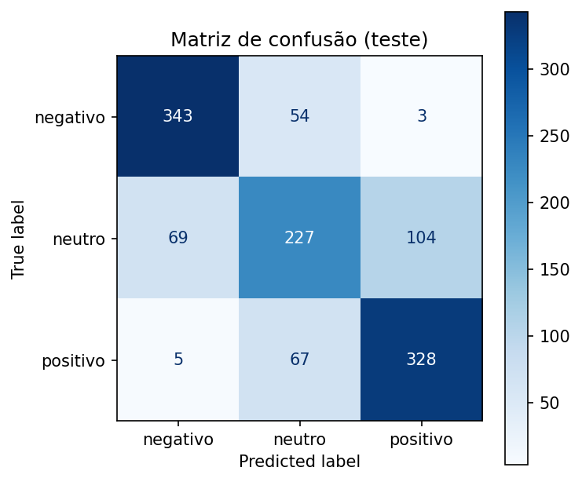

# Classificação de sentimento em português com BERTimbau + LoRA

Fine-tuning eficiente (LoRA) do [BERTimbau](https://huggingface.co/neuralmind/bert-base-portuguese-cased) para classificar avaliações em **negativo**, **neutro** ou **positivo**, comparado com um baseline clássico (TF-IDF + Regressão Logística).

**Modelo publicado:** [btriz/bertimbau-lora-sentimento-ptbr](https://huggingface.co/btriz/bertimbau-lora-sentimento-ptbr)

## Resultados

Avaliação em um conjunto de teste com 1.200 avaliações (400 por classe) que o modelo nunca viu durante o treino.

| Modelo | Acurácia | F1 macro |
|---|---|---|
| Baseline (TF-IDF + Regressão Logística) | 0,715 | 0,711 |
| **BERTimbau + LoRA** | **0,754** | **0,750** |

F1 por classe:

| Classe | Baseline | LoRA |
|---|---|---|
| Negativo | 0,79 | 0,84 |
| Neutro | 0,58 | 0,62 |
| Positivo | 0,76 | 0,79 |

O fine-tuning com LoRA superou o baseline nas três classes, com ganho de cerca de 4 pontos percentuais no F1 macro.

### Matriz de confusão (LoRA)



| Real \ Previsto | Negativo | Neutro | Positivo |
|---|---|---|---|
| Negativo | 342 | 55 | 3 |
| Neutro | 62 | 232 | 106 |
| Positivo | 6 | 63 | 331 |

## Análise de erros

- **A classe neutra é a mais difícil** (F1 de 0,62). O modelo confunde "neutro" principalmente com "positivo" (106 casos) e, em menor grau, com "negativo" (62 casos).
- **Erros graves são raros:** só 3 avaliações negativas foram classificadas como positivas e 6 positivas como negativas. Quase todo o erro acontece entre a classe do meio e as extremidades.
- **Por que isso acontece:** o rótulo vem da nota (1-2 = negativo, 3 = neutro, 4-5 = positivo). Uma nota 3 costuma misturar elogios e críticas no mesmo texto, então a fronteira entre neutro e positivo é naturalmente ambígua.

> **TODO (escreva com as suas palavras):** cole aqui 3 a 5 exemplos reais em que o modelo errou (seção 9 do notebook) e explique o que você acha que causou cada erro (ex.: texto curto, ironia, elogio e reclamação juntos).

## Como funciona

1. **Dados:** avaliações de e-commerce em português ([B2W-Reviews01](https://huggingface.co/datasets/ruanchaves/b2w-reviews01)) com nota de 1 a 5, convertida em 3 rótulos.
2. **Balanceamento:** até 4.000 exemplos por classe (12.000 no total), divididos em 80% treino, 10% validação e 10% teste, de forma estratificada.
3. **Baseline:** TF-IDF (unigramas e bigramas) + Regressão Logística.
4. **Fine-tuning com LoRA:** o BERTimbau fica congelado e só treinamos matrizes de baixo ranque nas camadas de atenção, mais a camada de classificação.
5. **Avaliação:** acurácia, F1 macro, F1 por classe e matriz de confusão no conjunto de teste.

### Configuração

| Item | Valor |
|---|---|
| Modelo base | `neuralmind/bert-base-portuguese-cased` |
| LoRA | r = 8, alpha = 16, dropout = 0,1 |
| Módulos alvo | `query` e `value` (atenção) |
| Learning rate | 2e-4 |
| Batch size | 32 |
| Épocas | 3 |
| Tamanho máximo do texto | 128 tokens |
| Parâmetros treináveis | _(cole aqui a linha do `print_trainable_parameters()`)_ |

## Como usar o modelo

```python
import torch
from transformers import AutoTokenizer, AutoModelForSequenceClassification
from peft import PeftModel

MODEL_NAME = "neuralmind/bert-base-portuguese-cased"
REPO = "btriz/bertimbau-lora-sentimento-ptbr"
ID2LABEL = {0: "negativo", 1: "neutro", 2: "positivo"}
LABEL2ID = {v: k for k, v in ID2LABEL.items()}

base = AutoModelForSequenceClassification.from_pretrained(
    MODEL_NAME, num_labels=3, id2label=ID2LABEL, label2id=LABEL2ID
)
modelo = PeftModel.from_pretrained(base, REPO).eval()
tok = AutoTokenizer.from_pretrained(REPO)

def prever(texto):
    entrada = tok(texto, return_tensors="pt", truncation=True, max_length=128)
    with torch.no_grad():
        probs = torch.softmax(modelo(**entrada).logits, dim=-1)[0]
    return {ID2LABEL[i]: round(float(p), 3) for i, p in enumerate(probs)}

print(prever("Chegou super rápido e o produto é ótimo, recomendo!"))
```

## Limitações

- **Domínio diferente:** o modelo foi treinado com avaliações de e-commerce, não de restaurantes. Em textos sobre comida e entrega de refeições, o desempenho pode ser pior, porque o vocabulário muda.
- **Rótulos derivados da nota:** o sentimento foi inferido da nota, não anotado por pessoas, então há ruído, principalmente na classe neutra.
- **Uma única execução:** os resultados vêm de um único treino e de um conjunto de teste de 1.200 exemplos. Diferenças de 1 a 2 pontos podem estar dentro da variação normal.
- **Dados balanceados artificialmente:** o conjunto original tem muito mais avaliações positivas. Em dados reais, a distribuição das classes seria diferente.

## Próximos passos

- Treinar com avaliações reais de restaurantes e delivery.
- Testar outros valores de `r` e outros módulos-alvo do LoRA.
- Repetir o treino com várias sementes e reportar média e desvio padrão.
- Criar uma demo com Gradio no Hugging Face Spaces.

## Tecnologias

Python, Hugging Face Transformers, PEFT (LoRA), Datasets, scikit-learn, PyTorch e Google Colab.
